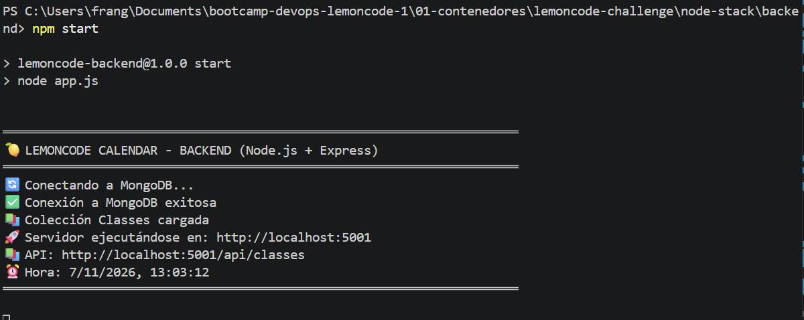
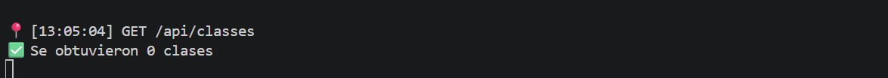

### 1. Crear Red
```bash
docker network create lemoncode-network
```
### 2. Levantar Mongo con persistencia
```bash
docker run -d --name mongodb --network lemoncode-network -p 27017:27017 -v mongo-data:/data/db -e MONGO_INITDB_ROOT_USERNAME="admin" -e MONGO_INITDB_ROOT_PASSWORD="password" mongo:latest
```
## 3. Ejecutar backend local apuntando a Mongo contenedor
```bash
PS C:\Users\frang\Documents\bootcamp-devops-lemoncode-1\01-contenedores\lemoncode-challenge\node-stack\backend> npm start
```


## 4. Verificar CRUD

