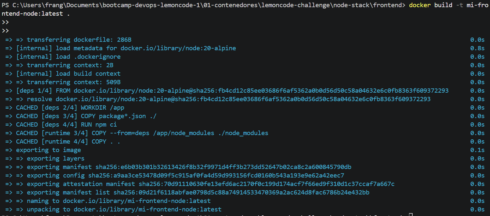
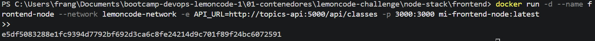
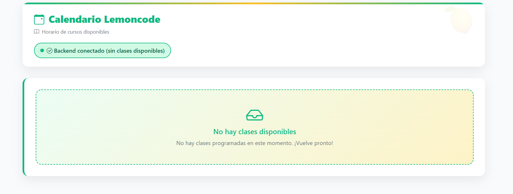

# 1. Crear un Dockerfile para el frontend
```dockerfile
FROM node:20-alpine AS deps
WORKDIR /app
COPY package*.json ./
RUN npm ci

FROM node:20-alpine AS runtime
WORKDIR /app
ENV NODE_ENV=production
COPY --from=deps /app/node_modules ./node_modules
COPY . .
EXPOSE 3000
CMD ["npm", "start"]
```

# 2. Construir la imagen del frontend

```bash
docker build -t mi-frontend-node:latest .
```


# 3. Ejecutar el frontend en un contenedor en la red Docker

```bash
docker run -d --name frontend-node --network lemoncode-network -e API_URL=http://topics-api:5000/api/classes -p 3000:3000 mi-frontend-node:latest
```


# 4. Configurar las variables de entorno para conectarse al backend en http://topics-api:5000/api/classes

